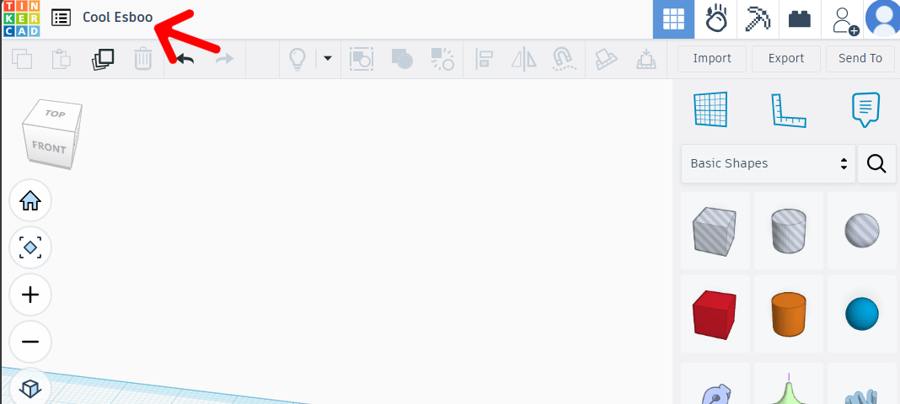
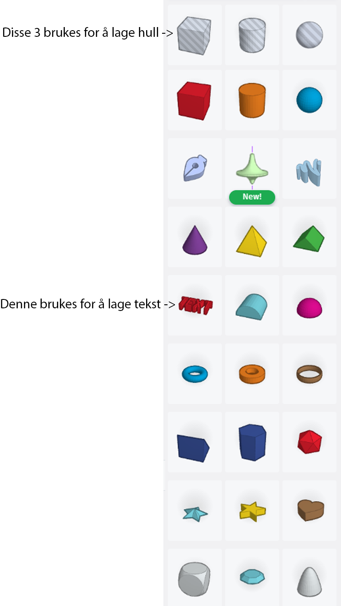
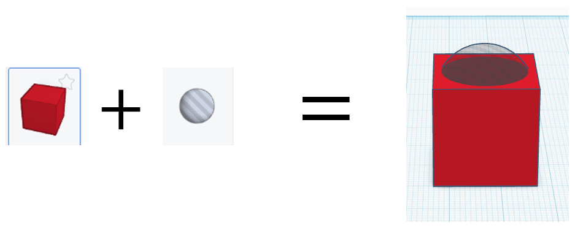
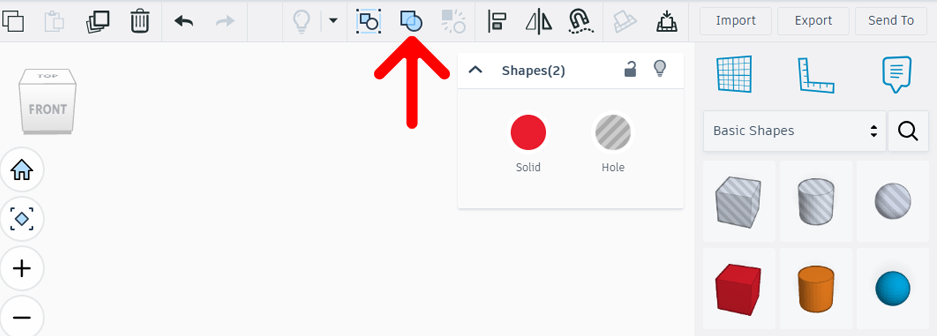
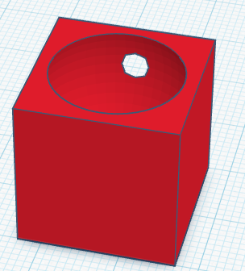
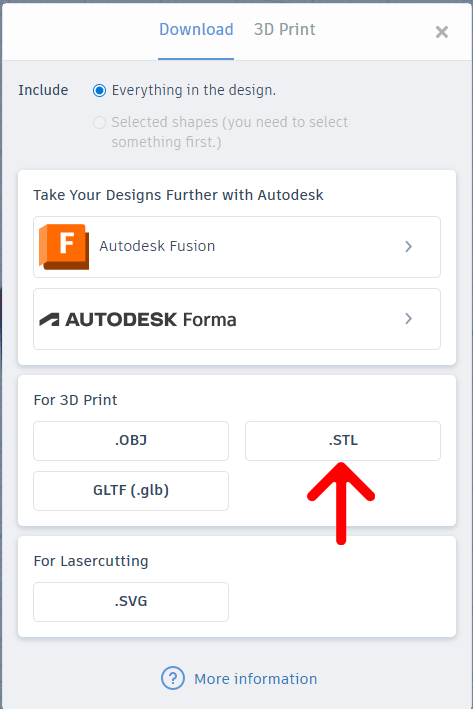

## Lag konto/logg inn på Tinkercad
1. Gå til [Tinkercad](https://Tinkercad.com)
2. Trykk på Sign Up i øverste høyre hjørnet for å lage en konto. Eller Log In hvis dere allerede har en Autodesk konto.
3. Velg 'Create a personal account'. Dere kan bruke skole eposten eller deres private epost. Dette bestemmer dere selv.
4. Når dere har laget kontoen og er logget inn, trykk på 
5. Velg '3D Design'.
6. Dere har nå laget et nytt design i Tinkercad og kan lage en 3D modell til 3D printing.
7. Jeg anbefaler at dere kaller prosjektet deres for noe logisk. Tinkercad lager prosjektnavn for dere, men disse er ofte lite forklarende på hva det er. Dette kan dere gjøre ved å klikke på prosjektnavnet her:
 

 

## Verktøy i Tinkercad
 

 

Slik lager du hull i modellen din:
 

 

Det kan lønne seg i mange tilfeller å sette ting sammen i grupper. Da kan du også få se hvordan hullet blir seende ut ved å velge de elementene i filen du vil sette sammen og trykk på denne knappen:
 

 

Etter du har satt sammen elementene i en gruppe. Så får du en bedre visuell fremstilling av hvordan hullet blir:
 

 

## Eksportering av modellen
1. Trykk på 'Export' i øverst høyre hjørnet.
2. Da får du flere valg. Velg .STL:
 

Gratulerer, du er nå ferdig med modulen om TinkerCad! 
Men det er fortsatt mye du kan lære om 3D modellering! 
Tinkercad har lagd en haug med interaktive guider på hvordan bruke ulike verktøy: 
[Learn how to use Tinkercad - Tinkercad](https://www.tinkercad.com/learn)
Og nedenfor har du flere verktøy du kan utforske i programmet.
## Flere verktøy i TinkerCad
### Linjal verktøyet
Om du er lei av å få to ulike former til å sitte i akkurat riktig avstand fra hverandre, så har vi løsningen i måle-verktøyet!

Her er det en guide på hvordan bruke det. Du kan både måle og sette avstander med verktøyet!
[Measure, Adjust, Keep Tinkering - Tinkercad](https://www.tinkercad.com/blog/measure)

## Align verktøyet

Om du er lei av at flere enn to former ikke vil være fordelt i forhold til hverandre, eller du savner bruken av flex i css så er dette verktøyet for deg!

[3D design Align It! - Tinkercad](https://www.tinkercad.com/things/0dVXiDeB7Dd/edit?lessonid=E531MFZJK2UJQIY&projectid=OF8ZOFPL1W5N9DS&collectionid=undefined&title=Align%20It#/lesson-viewer)

## Codeblocks

[Codeblocks - Tinkercad](https://www.tinkercad.com/codeblocks)
Om du er lei av å gjøre modeleringa __manuelt__ kan du bruke codebloks til å programmere design. Da bruker du blokkprogrammering til å definere 3D modellen din.