## Før du starter

- Lag en oppstartbar USB-minnepenn med Windows 11 ved hjelp av [Rufus](https://rufus.ie/nb/).
- Trekk ut nettverkskabelen på PC-en du skal installere Windows på.

## Installasjon av Windows 11 fra minnepenn - instans 1

Sett inn den oppstartsbare minnepennen og start datamaskinen mens du gjentatte ganger trykker på <key>F11</key>.

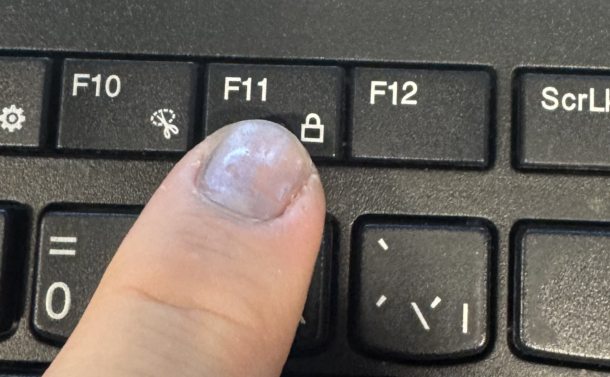

Du vil da komme inn i oppstartsmenyen. Velg USB-minnepennen og trykk på Enter.

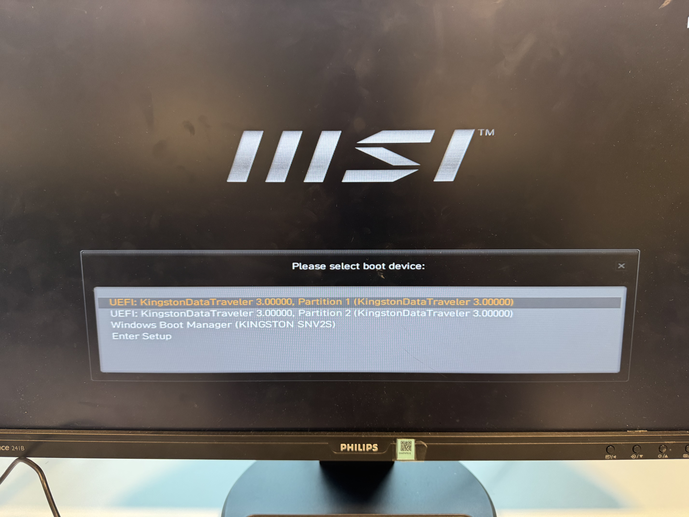


## Windows 11-installasjon
### Innstillinger for installasjonen

Velg språk og tastaturoppsett.

<div style="display: flex;flex-direction:row;align-items:center;justify-content:space-between;gap:10px">
	<div>
	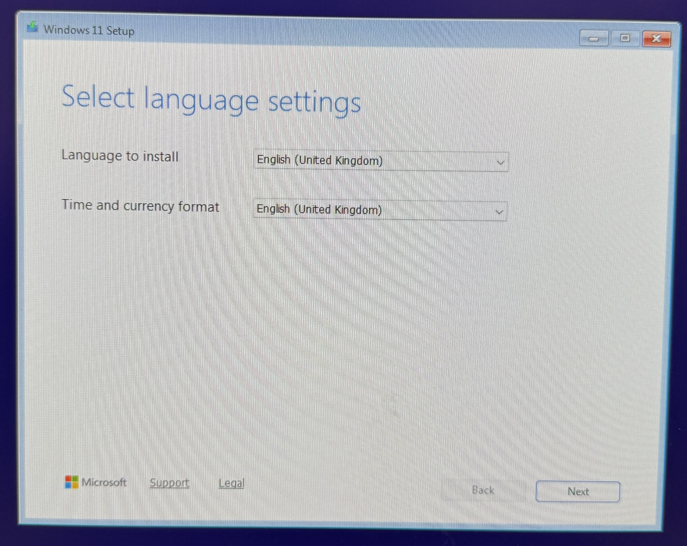
	</div>
	<div>
	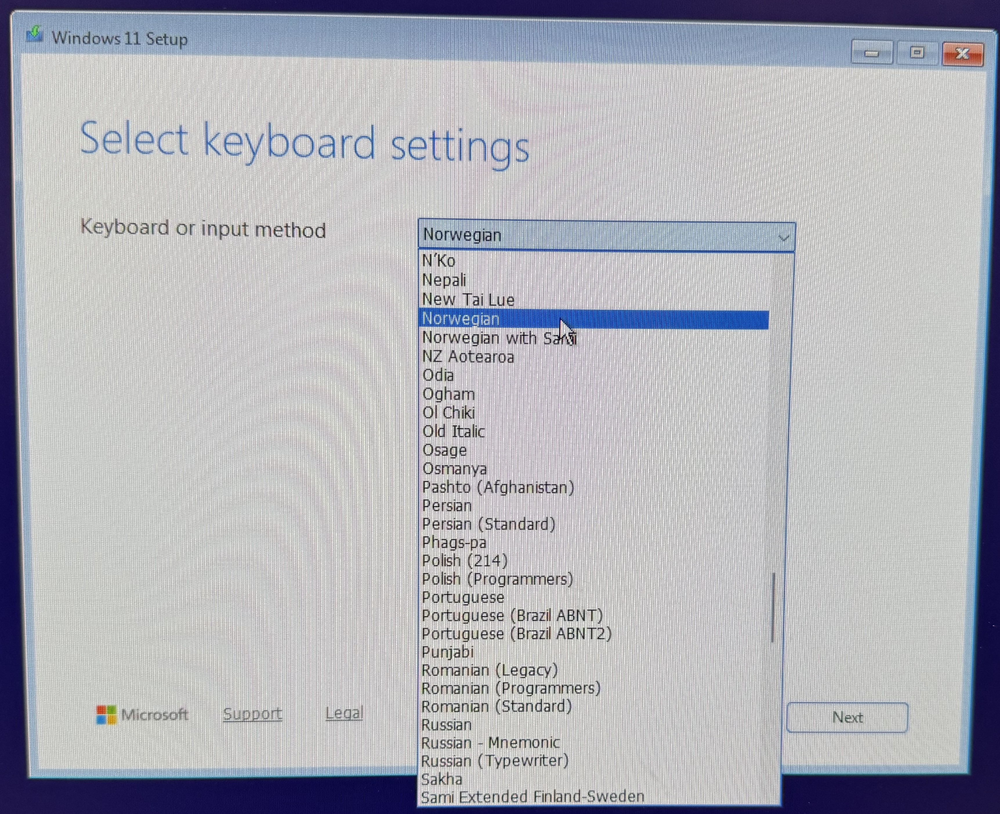
	</div>
</div>

Velg **Install Windows 11** og hak av på *I agree everything will be deleted including files, apps and settings*

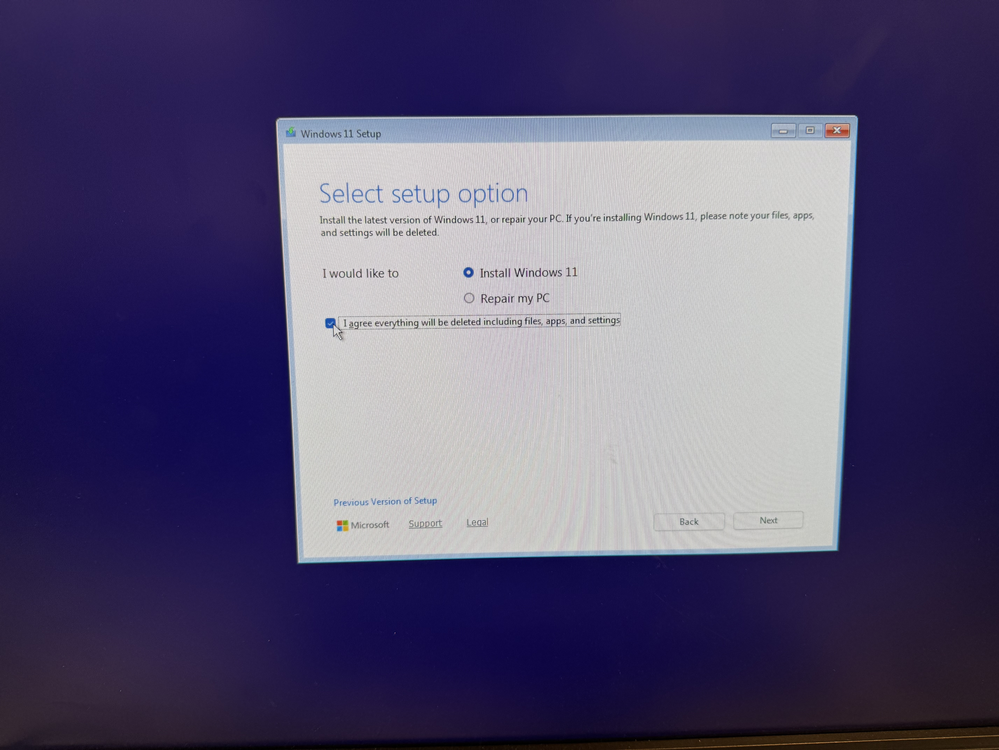

Product key: Trykk på *"I don't have a product key*

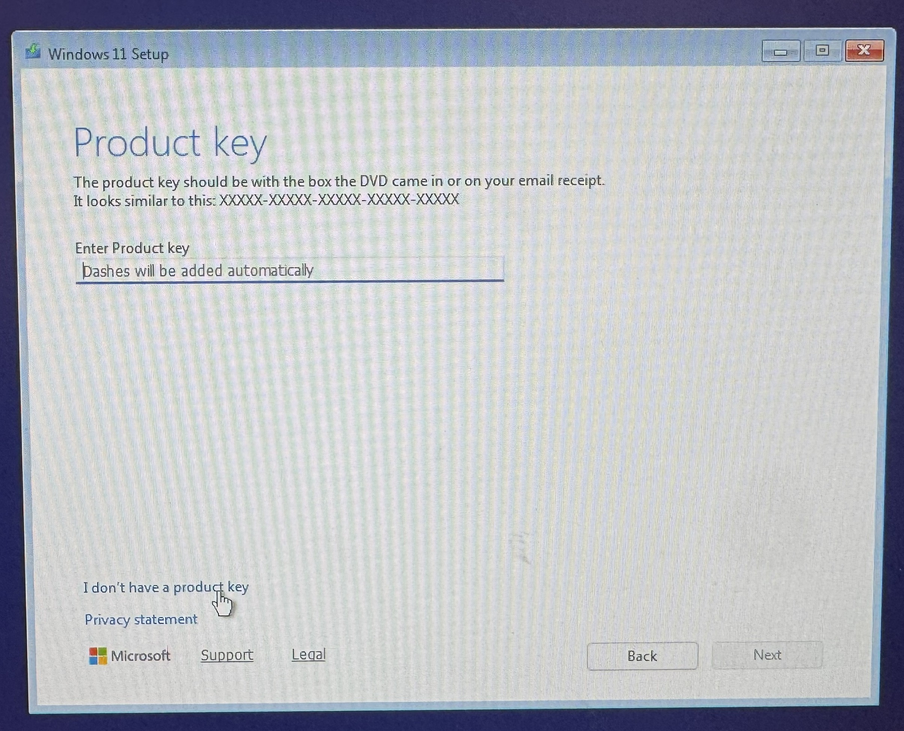

Velg Windows-versjon: **Windows 11 Pro Education**

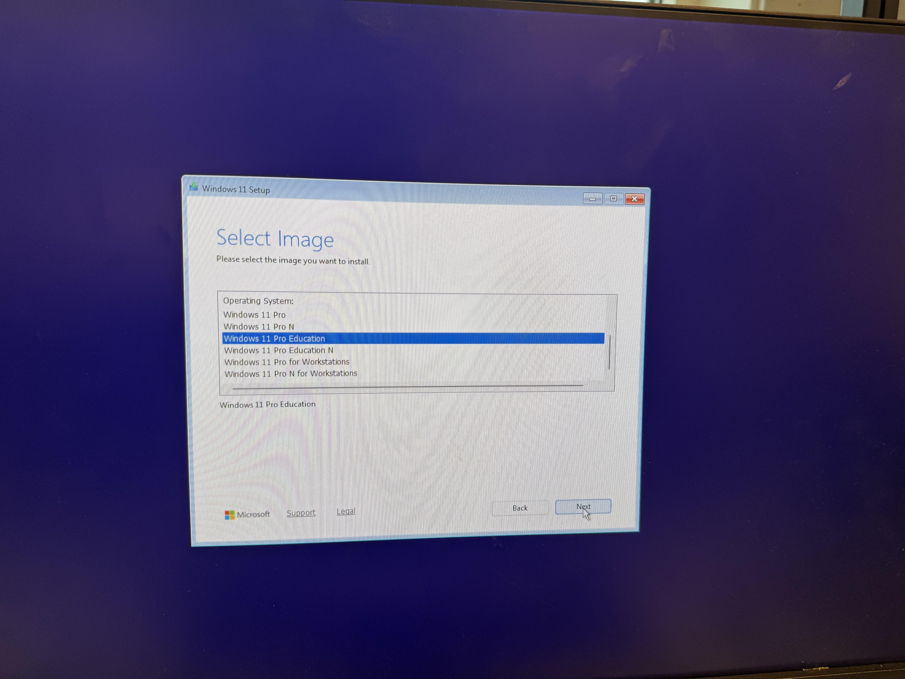

## Partisjonering (VIKTIG!)
*Dette skal du bare gjøre på den første Windows-installasjonen. Hvis det er installert en instans av Windows fra før, skal du bare velge **Unallocated Space** og trykke **Next**. Hvis Unallocated space har omtrent samme størrelse som Disk 0 Partition 3, er det et klart tegn på dette.* 

Siden vi skal installere to instanser av Windows må vi lage to partisjoner, som hver tar opp halve disken. Når du skal installere den første instansen, sletter du alle partisjoner på **Disk 0**.

Velg en og en partisjon og trykk på **Delete partition**. Når du har slettet alle partisjoner på Disk 0, skal det stå **Disk 0 Unallocated Space**. Det betyr at Disk 0 er tom.

<div style="display: flex;flex-direction:row;align-items:center;justify-content:space-between;gap:10px">
	<div>
	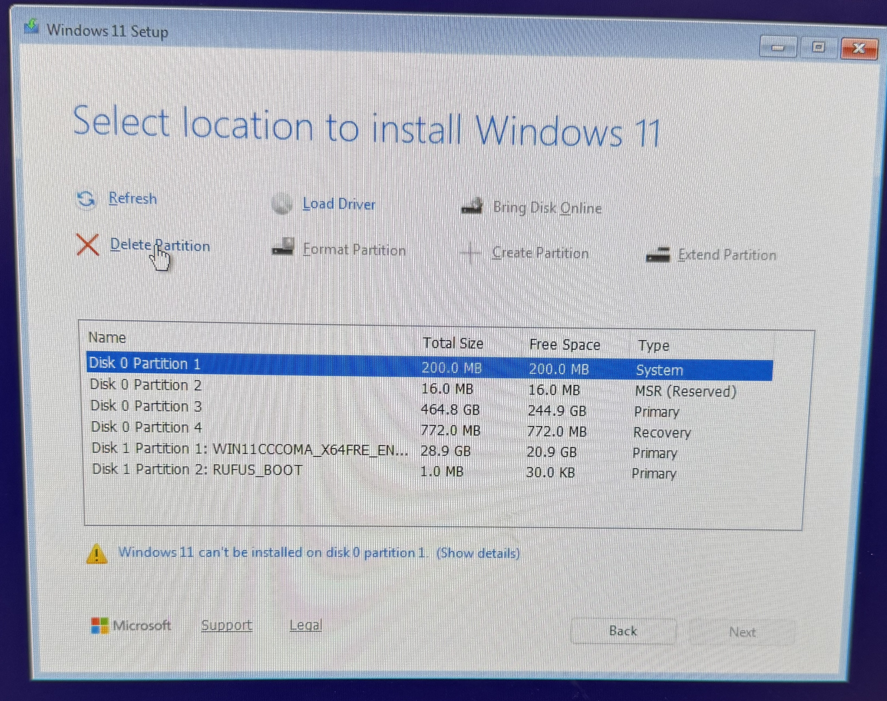
	</div>
	<div>
	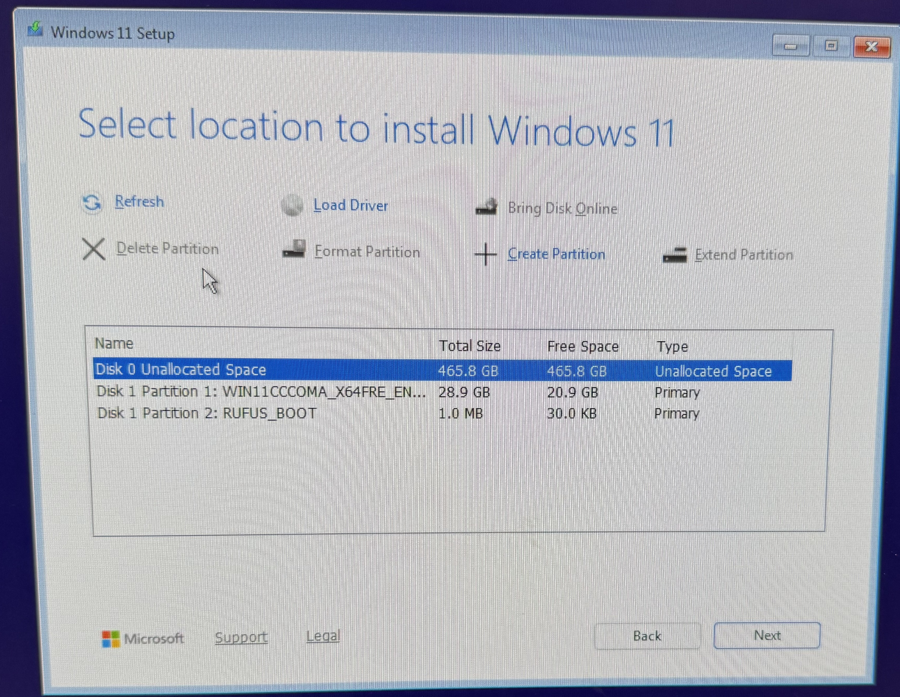
	</div>

</div>


Du skal nå lage en partisjon som tar halve disken. Trykk på **Create Partition**, og fyll ut hvor stor partisjonen skal være i feltet der det står **Size in MB**. Her skriver du omtrent halvparten av det som er fylt ut fra før, i dette tilfellet omtrent 238.000 MB. Trykk på **Apply** og vent til de nye partisjonene kommer opp i lista.

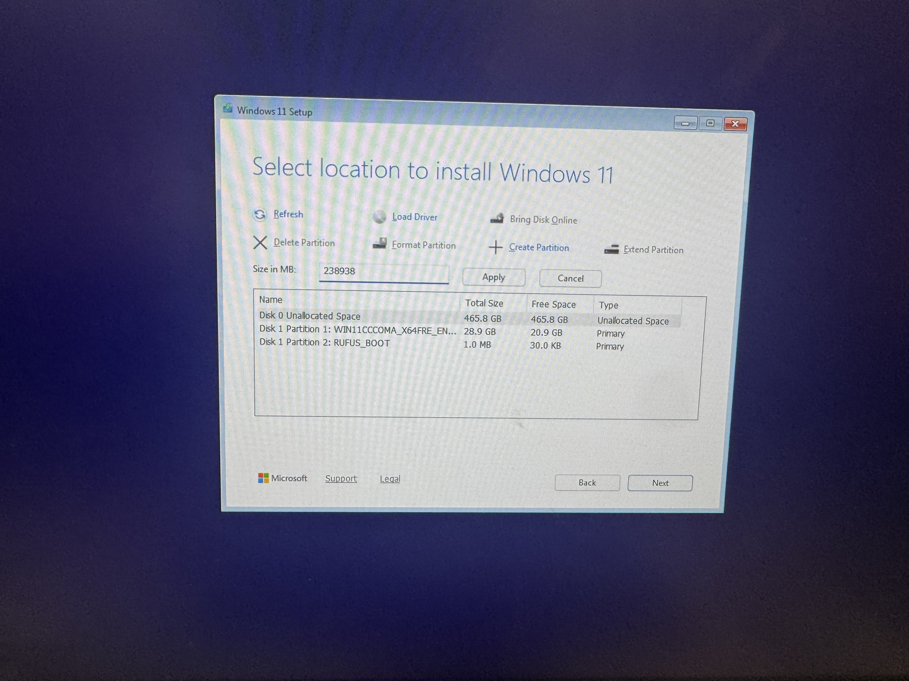

Windows lager nå tre partisjoner. Velg den største (Disk 0 Partition 3), og trykk **Next**. Trykk deretter på **Install**.


<div style="display: flex;flex-direction:row;align-items:center;justify-content:space-between;gap:10px">
	<div>
	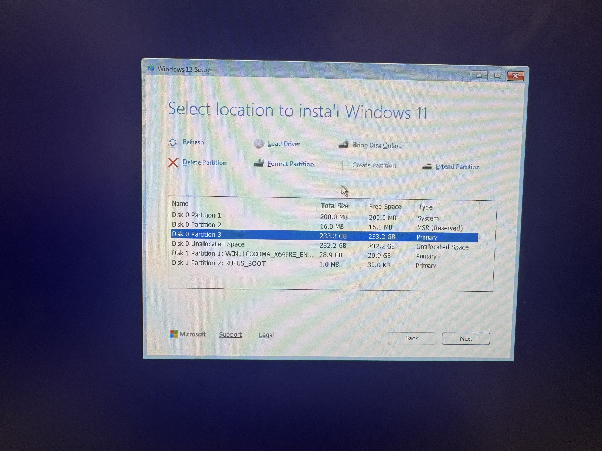
	</div>
	<div>
	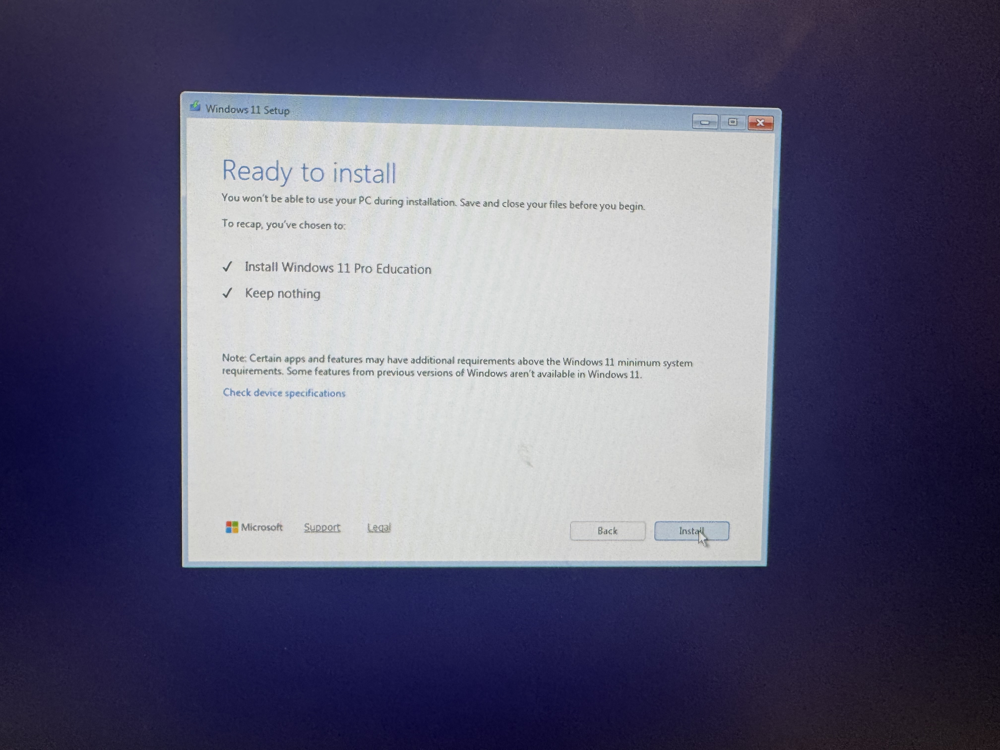
	</div>

</div>

Windows blir nå installert.


## Innstillinger i Windows 11

Når Windows er installert må du sette land- og tastaturinnstillingerog opprette en bruker.

Når du kommer til spørsmålet om å koble til et nettverk velger du **I don't have internet**. (Det er derfor du skulle koble fra nettverkskabelen fra starten av). Dette gjør at vi kan lage lokale brukerkontoer, og slipper å bruke Microsoft-konto.


Du trenger nå bare å fylle ut navn og passord for den nye brukeren. **Ikke fyll ut navnet ditt her**, men lag adminbrukeren **admin-a** hvis du går i klasse a eller **admin-b** hvis du går i klasse b. Sett passordet på denne brukeren til **VOVIM-a** eller **VOVIM-b**

<div style="display: flex;flex-direction:row;align-items:center;justify-content:space-between;gap:10px">
	<div>
	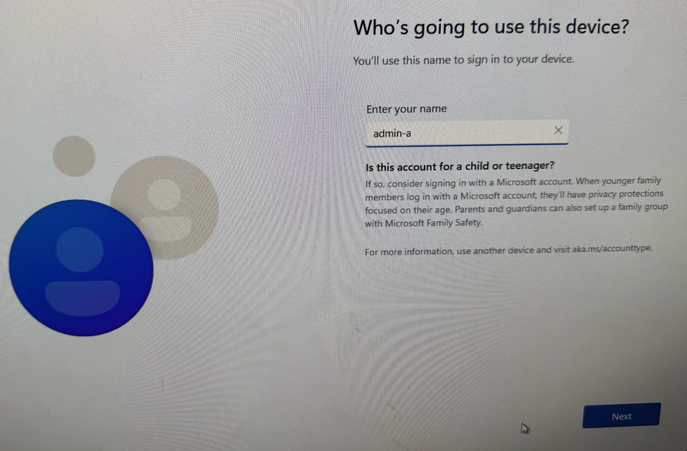
	</div>
	<div>
	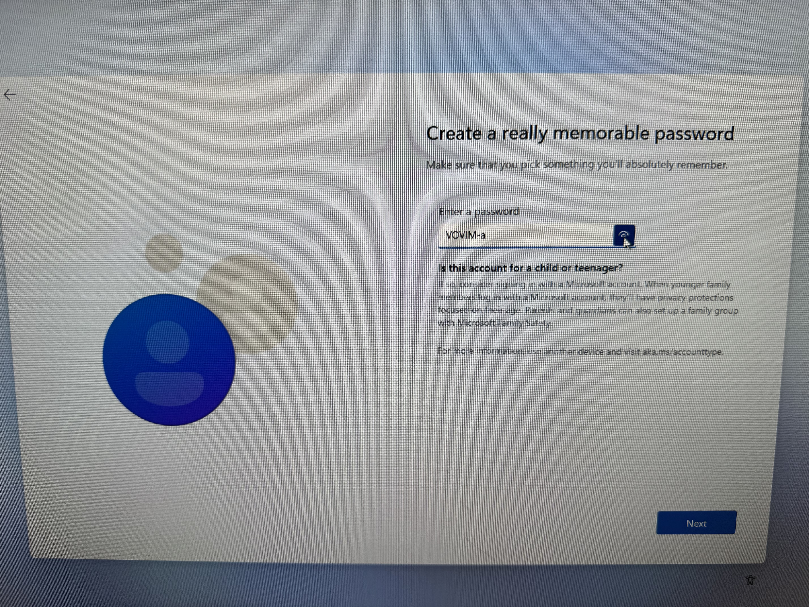
	</div>

</div>

Windows ønsker at du skal legge til tre sikkerhetsspørsmål i tilfelle du glemmer passordet ditt. For enkelthets skyld, bare velg et tilfeldig sikkerhetsspørsmål, og sett svaret til **VOVIM** på alle tre spørsmålene.


Når du er ferdig med å sette innstillingene, er den første instansen av Windows installert. Det er nå klart til å installere den andre instansen. Da starter du på nytt i denne guiden og gjør alle stegene **unntatt partisjonering(!)** på nytt.

Når du kommer til valget **Select Location to install Windows 11**, velger du **Disk 0 Unallocated Space** og trykker på **Next**. Windows-installasjonsprogrammet vil da opprette de nødvendige partisjonene automatisk.


## Sette opp oppstartsmeny

Når du starter datamaskinen etter at de to instansene av Windows er installert, vil du komme til en oppstartsmeny der du kan velge hvilken Windows-instans du vil starte. Det vil stå **Windows 11** på begge to, og et nummer for hvilken disk de ligger på. Vi skal nå endre denne menyen, så det blir enklere å vite hvilken man skal velge.

Logg inn på den ene instansen, f.eks. VOVIM-b (brukernavn: admin-b, passord: VOVIM-b). Hvis det ikke fungerer, har du valgt feil i oppstartmenyen.

Inne i Windows, søk opp **Command Prompt (CMD)** i start-menyen, høyreklikk på den og velg **Run as administrator**.


I kommandovinduet skriver du følgende kommando:

```shell
bcdedit /set {current} description "Windows 11 VOVIM-b"
```

Restart maskinen, og du vil se at den ene instansen i oppstartsmenyen er endret til navnet du satte i kommandoen.


Logg inn på den andre instansen og kjør samme kommando der.