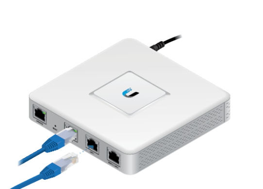

### Resetting av USG ruter

Sett strøm på ruteren. Den vil nå starte opp og lyset rundt logoen på toppen vil begynne å blinke. 
2. **Vent ca 1 minutt** til lyset på toppen lyser fast.
3. Stikk en binders inn i det lille hullet på forsiden av ruteren. Hold bindersen der i ca 10 sekunder, **til lyset oppå ruteren** slås av.
4. Ruteren vil nå starte på nytt og begynne å blinke. Vent ca ett minutt til lyset blir fast igjen. Hvis alt er som det skal, skal lyset være hvitt.
Hva de ulike lyssignalene betyr er nærmere forklart på UniFi [sine sider](https://help.ui.com/hc/en-us/articles/204910134-Understanding-Device-LED-Status-Indicators).

## Oppsett av USG ruter

Åpne en nettleser på datamaskinen din. I adressefeltet skriver du **192.168.1.1** (hvis det ikke fungerer, prøver du 192.168.0.1, eller 10.0.0.1).

Du vil nå få opp et skjema der du skal fylle inn innformasjon om nettverket ditt.

### Oppsett på statiske nettverk:

#### Konfigurering av WAN instillinger
Connection type: **Static IP** ( Ikke dynamisk tildelt adresse)
2. IP address: **Ruter-IP WAN** (Din unike offentlige adresse)
3. Subnet mask: **255.255.240.0** (Angir størrelsen på nettverket vi kobler oss til)
4. Router: **172.20.0.1**: (Gateway WAN, hvor vår ruter finner WAN ruteren )
5. Preferred DNS: **172.20.0.1**
6. Alternate DNS: **1.1.1.1**
7. Use VLAN ID: Nei 

#### Konfigurering av LAN instillinger
IP address: **192.168.1.1** (Ruterens private adresse)
2. Subnet mask: **255.255.255.0** (Størrelsen på LAN)
3. DHCP Server: **ON** (Om ruteren skal tildele dynamiske ip-adresser)
4. DHCP Range: **192.168.1.6**-**192.168.1.254** (Hvilke adresser den skal tildele)